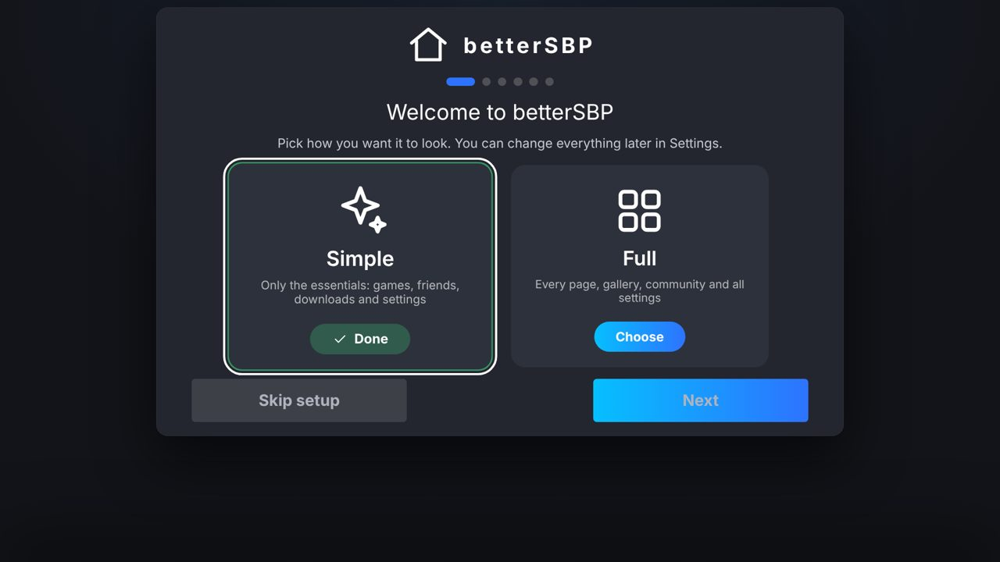
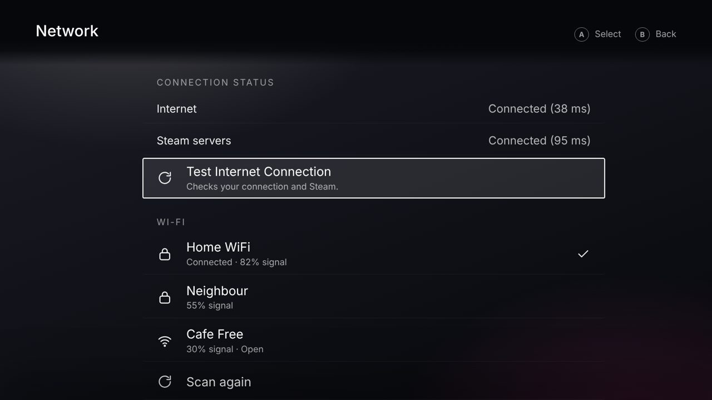
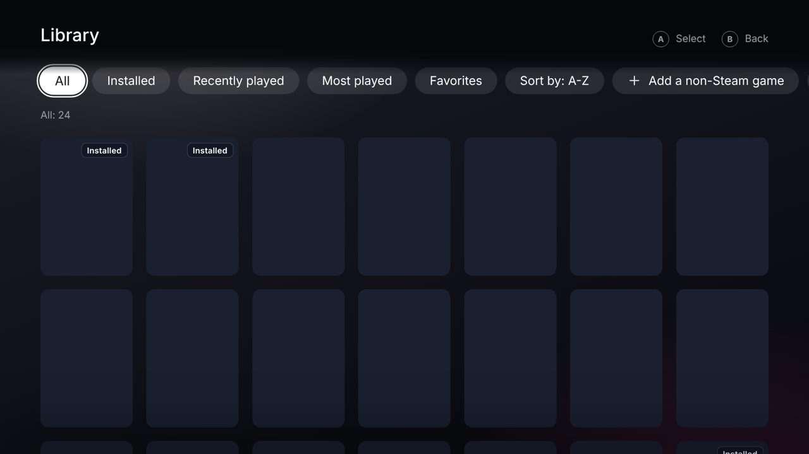

<div align="center">

# betterSBP

**A console-style, controller-first replacement for Steam Big Picture on Windows.**
Games, store, friends, chat, downloads, Wi-Fi and Bluetooth in one fullscreen dashboard, all inside its own UI.

[**Download**](../../releases/latest) · [Features](#features) · [Install](#install) · [Build from source](#build-from-source) · [Controls](#controls) · [FAQ](#faq)


<sub>Screenshots use demo data.</sub>
</div>

> Fan project. Not affiliated with or endorsed by Valve, Sony, Microsoft or Discord. Their names and logos belong to their owners.

## Install

1. Open the [**Releases**](../../releases/latest) page.
2. Download **betterSBP-Setup-x.y.z.exe** and run it (one click, adds Start menu and desktop shortcuts). Or grab **betterSBP-Portable** to run without installing.
3. First launch shows a short setup: pick Simple or Full, sign in to what you use, set Wi-Fi/Bluetooth and preferences.

Windows SmartScreen may warn because the app is not code-signed: click **More info > Run anyway**.

## Features

| | |
|---|---|
| **Library and Home** | Installed Steam games from every drive, non-Steam shortcuts, artwork and soundtrack fetched automatically, launch without opening Steam when possible |
| **Store** | Browse, search, trailers, screenshots, reviews, cart, all in-app |
| **Friends and chat** | Steam, Xbox and Discord friends, message history, typing, pop-ups for new messages, Discord voice |
| **Downloads** | Steam downloads through SteamCMD using the same in-app Steam login |
| **Media** | YouTube (ad block, SponsorBlock, console look) and Xbox Cloud Gaming |
| **Network** | Wi-Fi and Bluetooth with the app's own UI, no Windows dialogs |
| **Settings** | Sound, screen, storage, accessibility, notifications, controller glyphs (Xbox / PlayStation), Simple mode |
| **Controller first** | Gamepad, keyboard and mouse everywhere, on-screen keyboard with arrow-key typing |

<table><tr>
<td></td>
<td></td>
<td></td>
</tr></table>

## Controls

| Action | Gamepad | Keyboard |
|---|---|---|
| Move | D-pad / stick | Arrow keys |
| Select / Back | A / B | Enter / Esc |
| Options / Search | X / Y | O / F |
| Switch tab | LB / RB | Q / E |
| Control Center | Guide / Start | F1 / Home |
| Back to betterSBP after a game | | Ctrl+Alt+D |
| Screenshot | | F12 |
| Quit | | Ctrl+Q |

## Build from source

Needs [Node.js](https://nodejs.org) 20+ on Windows.

```bash
npm install
npm start          # run
npm run dist       # build installer + portable exe into ./release
```

Or double-click **build.bat**.

## FAQ

**Do I need the Steam app running?** No for browsing, chat, downloads and launching most games. Some games refuse to start without it; betterSBP offers to launch those through Steam.

**Where are my passwords kept?** Sign-ins stay on your PC. The optional download login is encrypted with Windows' secure storage and can be turned off in Settings > Downloads.

**Too cluttered?** Simple mode is the default. Settings > Simple mode, and *Show all settings* for the rest.

**Re-run setup?** Settings > Run setup again.

**Something does not work.** Wi-Fi, Bluetooth, Xbox pop-ups and Discord voice depend on Windows and service behavior. Open an issue with what you did and what happened.

## Notes

Data folder: `%APPDATA%/betterSBP`. Older release notes are in [CHANGELOG.md](CHANGELOG.md). License: [MIT](LICENSE).
